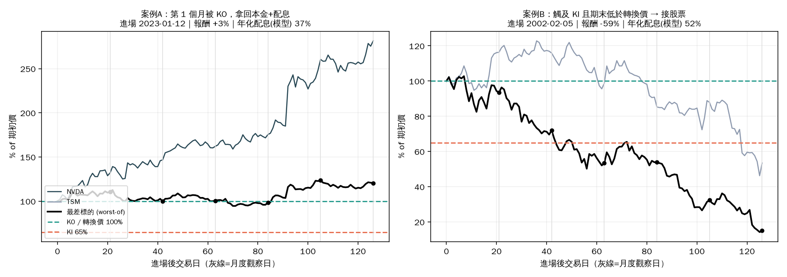
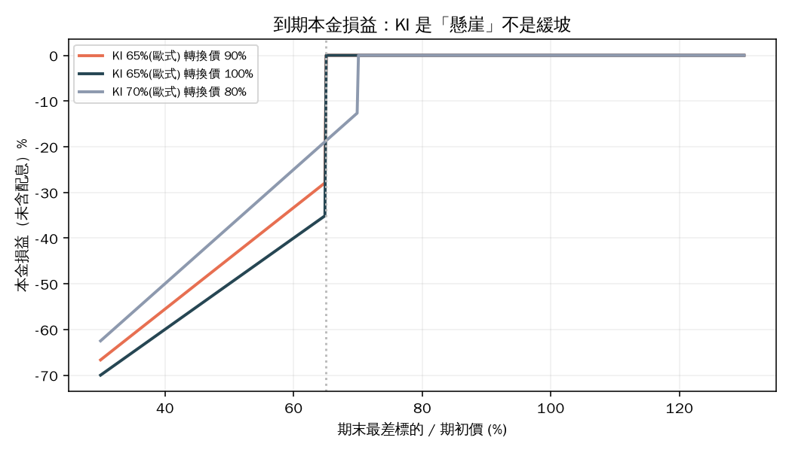
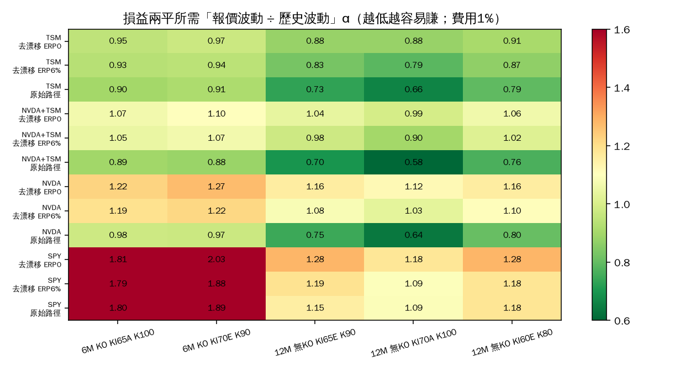
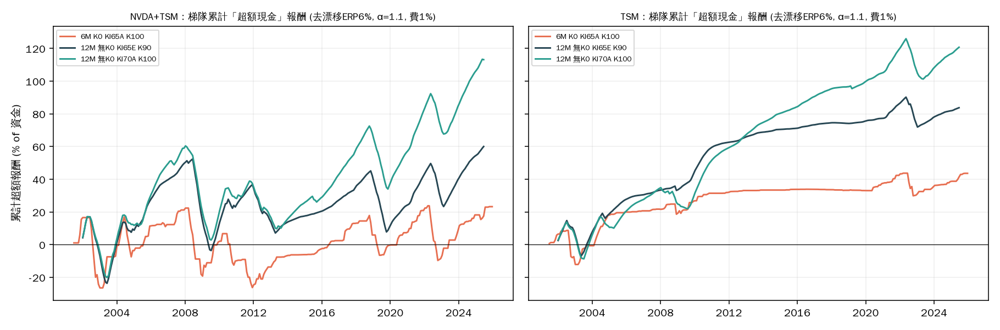

# FCN 交易流派研究與歷史回測報告

> 一句話結論：**FCN 的「高成功率」是結構造成的（單張勝率 70–93%），不是 alpha。**
> 在去除 NVDA/TSM 事後贏家偏誤後，絕大多數常見結構的期望超額報酬 ≤ 0；
> 唯一在多個情境下信賴區間為正的，是「**TSM 單一標的 × 12 個月 × 不設 KO × 中等 KI**」，
> 且前提是券商報價隱含波動 ≥ 你自己估的歷史波動的 ~1.1 倍。**我沒有找到可以保證高成功率的策略，下面只寫我能證明的。**

---

## 0. 先講限制（請先讀）

| 項目 | 實際情況 |
|---|---|
| YouTube 內容 | **無法萃取**。環境的出口 proxy 擋掉 youtube.com 與絕大多數網站全文（WebFetch 全部 EGRESS_BLOCKED），只拿得到搜尋引擎的**標題與摘要**。所以第 1 節的「流派」是整理搜尋摘要 + 產品結構知識，**不是影片逐字稿**。 |
| 價格資料 | 只有 repo 內嵌的 NVDA / TSM / ARM / SPY 日線（2000-01 ~ 2026-07，Yahoo 快照）。Yahoo、Stooq 等被擋，無法擴充標的。 |
| 選擇權/報價資料 | **沒有任何真實 FCN 報價或隱含波動率**。配息是用「進場當天可得的歷史波動 × α」的模型算出公平價再扣費用，α 是參數而不是觀察值。 |
| 倖存者偏誤 | NVDA、TSM 都是 2000–2026 的超級贏家（NVDA 起漲數百倍）。**原始路徑的回測結果會嚴重偏樂觀**，所以我另外做了「去漂移」情境（見 §3）。 |
| ARM | 只有 2023-09 後資料，含 ARM 的籃子只有約 20 個進場日，**不下結論**。 |
| GitHub | `git push` 被拒（403，Claude 對此 repo 無寫入權限），本報告目前只在本機 commit；見文末。 |

---

## 1. 研究：FCN 是什麼、流派怎麼分

### 1.1 結構（怎麼看一張 FCN）

資料來源（搜尋摘要）：[元大境外結構型商品簡介](https://www.yuanta.com.tw/eyuanta/webfile/resourcesFile/0f15610b-6157-4df6-884d-63dd3bf0c5dd.pdf)、
[中信證 FCN](https://www.ctbcsec.com/OffShoreStructured/FCN)、
[富途 FCN 結構](https://money-plus.futuhk.com/static-page?id=725&lang=zh-hk)、
[璞耀 AKI vs EKI](https://puyao.com.tw/fcn/article/fcn-aki-vs-eki/)、
[Cega：FCN 結構](https://docs.cega.fi/cega/products/overview/bond-+-options-strategy-b+o/understanding-the-structure-of-a-fixed-coupon-note)。

看條款只要抓 6 個欄位（價位都以**期初價 = 100%**）：

| 欄位 | 白話 | 常見值 |
|---|---|---|
| 標的 1~N 檔 | **worst-of**：只看最差那檔 | 1–5 檔 |
| 天期 | 3–12 個月（多為 3–6） | 6M |
| KO（提前出場價） | 月度觀察，全部標的 ≥ KO 就結束、拿回本金 + 已配息 | 95–105% |
| KI（下限價）與型態 | **AKI（美式）**：存續期間任何觀察日跌破即觸發；**EKI（歐式）**：只看到期日 | 50–70% |
| 轉換價 Strike | 觸發 KI 後要「用這個價」接股票 | 60–100% |
| 月配息 | **無條件**領到 KO 或到期為止（不是看股價才給） | 年化 10–40% |

本質上：**你賣了一張 worst-of 賣權（put）給券商，配息 = 權利金 + 利息**。
懸崖在 KI：沒觸發 → 本金全回；觸發且期末 < 轉換價 → 以轉換價接貨，**當下就是虧損**（見圖 2）。


*圖 1：同一個結構（NVDA+TSM、6M、KO100、KI65 美式、轉換價 100）的兩個真實案例。黑線 = worst-of，月度觀察日打點。左：2023-01 進場，第 2 個月 KO，賺 +3%（只拿 2 期配息，上漲全被切掉）；右：2002-02 進場，一路下跌穿 KI、期末 15%，轉換虧 −59%，配息補不回來。*


*圖 2：到期本金損益。注意 KI 是「懸崖」：跌到 64% 的損失 = 25–29%，不是 1%。*

### 1.2 流派（整理自搜尋摘要 + 結構常識；**無影片逐字稿佐證**）

| 流派 | 主張 | 典型設定 |
|---|---|---|
| **A. 高息追逐派** | 挑高波動、低相關的標的組成 worst-of，配息拉到 25–40% | NVDA/TSLA/AMD 籃子，KI 60–70 |
| **B. 想買才賣派** | FCN = 把理想買點寫進合約，等待期間照領配息；只連結「你本來就願意持有」的公司 | 大型股 1–2 檔，轉換價 80–90 |
| **C. 防守/分散派** | 多標的降單一風險、KI 設低、EKI 優於 AKI、分批進場錯開到期日、單檔部位設上限 | KI 55–60 EKI，梯隊 |
| **D. 擇時派** | 在大跌後/高波動時賣（權利金較肥）、避開過熱 | 回檔進場 |
| **E. 反方（拆解派）** | 配息是風險補償不是免費午餐；券商抽 2–3%、發行延遲 T+14 把天期灌水、KO 其實是讓銀行多賺、KI 只是減少虧錢「次數」但虧時更大（[Threads 討論](https://www.threads.com/@fomo_soc/post/DW6il5wGZQS)、[老 Best](https://loubest.com/fixed-coupon-note/)、[Vulpes](https://vulpesinvest.com/vailstr/%E4%B8%BA%E4%BB%80%E4%B9%88fcn/)） | — |

搜尋到的 YouTube 教學（只能看到標題，未能讀內容）：
[一起來了解 FCN](https://www.youtube.com/watch?v=Bw7tbaMr3wg)、
[FCN 實例解析：台積電 ADR 案例](https://www.youtube.com/watch?v=BI__UvzKbtU)、
[理財最錢線：結構型商品投資前必知 3 件事](https://www.youtube.com/watch?v=S_KSgJNd-G0)、
[富邦學Bar EP18](https://www.youtube.com/watch?v=9PJb69Y-sZQ)。
若你想要真正的影片內容，需要在可連 YouTube 的環境把字幕丟進來，我可以接著做同樣的「假設→回測」。

### 1.3 怎麼佈局（本研究回測後的實務清單，見 §5）

> 進場前問三件事：① 配息夠不夠補**歷史實證**的轉股損失（§6 報價檢查器）；② 你願不願意在轉換價接這檔；③ 這張最壞會賠多少、佔總資產幾 %。

---

## 2. 方法：假設 → 實驗 → 檢討

引擎：`fcn_engine.py`、`build_grid.py`。

1. **定價（模型）**：進場日當下，用 `sqrt(0.5·σ60² + 0.5·σ250²)` 估波動、120 日相關係數，風險中立 GBM 蒙地卡羅 2000 條路徑（對偶變異數），求使 FCN 現值 = 1 − 費用 的月配息。報價 = 公平價(以 σ×α) − 費用。
   - α = 券商報價隱含波動 ÷ 你看的歷史波動；掃 0.9–1.3。費用預設 1%/張（掃 0–2%）。
2. **實現（歷史）**：同一組條款套到進場日之後的**真實**價格路徑結算（KO 月度觀察、AKI 用每日收盤、EKI 只看到期）。
3. 每月進場一次（2000-12 ~ 2026-06，約 300 個進場日 × 180 種條款 × 3 個主要籃子）。
4. **三種「世界」**（避免倖存者偏誤）：
   - `asis`：原始路徑（偏樂觀，僅供參考）。
   - `erp6`：保留真實波動/跳空/崩盤時序，把期望報酬重設為 rf + 6%。
   - `erp0`：期望報酬 = rf（風險中立；公平定價下期望損益應≈ −費用）。
5. **樣本內/外**：2000–2012 vs 2013–2026；信賴區間用「按年份」區塊拔靴（2000 次）。
6. 績效基準 = 同期無風險利率（超額報酬 `ann_excess` = 每「資金-年」超過現金的報酬）。

> 注意：在 `erp0/erp6` 世界，公平價 α=1 理應期望值≈0。實測**更負**（−3% ~ −8%/年），代表純 GBM + 追蹤波動**低估**了真實的跳空/波動叢集尾部。所以「α>1」不是奢求，是補這個尾部的最低要求。

---

## 3. 實驗與檢討

### H1：「KI 設越低越安全」？ ✗ 不成立（以價值計）
NVDA+TSM、6M、KO100、α=1、費 1%、`erp6`，超額報酬（年化）：

| 轉換價 | KI55 | KI60 | KI65 | KI70 | KI75 |
|---|---|---|---|---|---|
| 美式 K100 | −7.6% | −5.5% | −2.4% | +0.4% | +1.0% |
| 歐式 K100 | −7.2% | −5.5% | −4.1% | −1.8% | +0.1% |

- 降 KI 只是用「低配息」換「少觸發」：**CVaR5 (最慘 5% 單) 沒有改善**（KI55 −55%、KI75 −47%）。
- EKI vs AKI：EKI 轉股次數少（7.7% vs 12.7%，原始路徑），但**每塊錢風險換到的報酬並沒更好**（同 KI 下期望值 A ≥ E）。它降低的是「痛的頻率」，不是「期望損失」。
- 檢討：安全感 ≠ 期望值。選 KI/EKI 要看「報價是否比公平價肥」，不是看「看起來安不安全」。

### H2：擇時濾網（趨勢、過熱、回檔、波動飆升）？ ✗ 大多無效
各濾網相對無濾網的 Δ 超額報酬（去漂移 ERP6%，平均 3 籃子 × 4 結構），樣本內 / 樣本外：

| 濾網 | train | test | 判定 |
|---|---|---|---|
| SPY > 200MA | −1.7% | −0.5% | 無效 |
| 最弱標的 6M 動能 > 0 | −3.7% | +1.0% | 不一致 |
| 不過熱（+30% vs 200MA 以內） | +0.6% | −2.1% | 不一致 |
| **回檔 10–35% 才進場（買跌）** | −6.8% | −5.2% | **有害** |
| **波動飆升(σ20/σ250>1.2)且 SPY 未崩** | −13% | −10% | **有害（最糟）** |
| 低波動期進場（σ20/σ250<0.9） | +0.7% | +2.6% | 唯一兩段同號，幅度小 |

- 檢討：「大跌後權利金肥、該賣」的直覺**被推翻**：波動有叢集性，跌後常繼續跌，肥配息補不了後續轉股。
- 唯一穩的訊號是「**短期波動低於長期**」時進場略佳（+1~3%），證據弱，不拿來當核心。

### H3：用波動度決定 KI（KI = exp(−z·σ·√T)）？ ✗ 沒有免費午餐
z=1.0（KI≈73%）超額最高但 CVaR 較差（−35% vs 固定 KI65 的 −31%）；z=2.0（KI≈55%）配息低、超額最低。這只是沿著同一條「風險-報酬」線移動。

### H4：天期與 KO 條款 ✓ 有顯著效果
NVDA/TSM/NVDA+TSM 平均（KI65A K90、α=1、費 1%、`erp6`）：

| 天期 | 有 KO | 無 KO |
|---|---|---|
| 3M | −8.4% | −5.0% |
| 6M | −3.4% | −0.4% |
| 12M | −0.7% | **+1.0%** |

- **KO 平均吃掉 ~3%/年**：被 KO 時你只拿到幾期配息，上漲被切掉，而下跌留給你；符合反方流派「被 KO 是銀行賺」的說法。
- **短天期最差**：費用是「每張一次性」，3M 年化後 = 4%/年。**拉長天期、少換單**。

### H5：標的選擇 ✓ 最重要的變因 → 損益兩平 α（圖 3）
α_be = 要讓期望超額報酬 = 0，**報價隱含波動需為你看的歷史波動的幾倍**（費 1%）。越低越容易賺：



| 籃子 | 去漂移情境下的 α_be | 解讀 |
|---|---|---|
| **TSM（單檔）** | **0.79 – 0.97** | 歷史波動定價就夠賺（12M 無 KO 最低 0.79–0.88） |
| NVDA+TSM | 0.90 – 1.10 | 要有 ~1.0–1.1 的波動溢價 |
| NVDA（單檔） | 1.03 – 1.27 | 跳空/崩盤太大（2000–02 −90%、2004 −35% 一天），需 1.1–1.2 以上 |
| SPY（對照） | 1.09 – 2.03 | 配息太低，費用吃光；**低波動標的不適合收 FCN** |

> 原始路徑(`asis`)下 α_be 降到 0.6–0.9，那是贏家偏誤，不要信。

### H6：梯隊（ladder）與「成功率」
月月進場一張，6M 單 6 格 / 12M 單 12 格滿載，去漂移 ERP6%、α=1.1、費 1%：

| 組合（結構） | 年化配息(模型) | 年化超額 [90% CI] | 單張賺錢率 | 轉股率 | 最慘一張 | 梯隊最大回撤 | 任一 12 個月勝現金 |
|---|---|---|---|---|---|---|---|
| **TSM 12M 無KO KI65E K90** | 8.3% | **+3.8% [+2.0, +5.5]** | 93% | 6.8% | −43% | −22% | 88% |
| **TSM 12M 無KO KI70A K100** | 12.9% | **+5.5% [+3.2, +7.7]** | 84% | 18.7% | −41% | −25% | 83% |
| TSM 12M 無KO KI60E K80 | 6.3% | +2.6% [+1.1, +4.2] | 90% | 5.4% | −42% | −16% | 80% |
| TSM 6M KO KI65A K100 | 13.6% | +4.6% [−0.6, +9.4] | 76% | 4.0% | −53% | −21% | 72% |
| NVDA+TSM 12M 無KO KI70A K100 | 25.3% | +5.5% [0.0, +10.6] | 68% | 42% | −63% | **−58%** | 68% |
| NVDA+TSM 6M KO KI65A K100 | 32.6% | +2.7% [−6.2, +12.4] | 83% | 17% | −59% | −49% | 68% |
| NVDA 6M KO KI65A K100 | 29.3% | −3.7% [−13.2, +6.5] | 79% | 16% | −65% | **−92%** | 62% |


*圖 4：梯隊累計超額報酬（去漂移 ERP6%）。三個坑一目了然：2002–03 網路泡沫、2008–09、2022。NVDA 系的梯隊在泡沫期單一階段就能回吐 −50% ~ −90% 的資金。*

- 高配息組合（NVDA、NVDA+TSM）信賴區間**跨過 0**、回撤巨大；
- TSM 單檔 12M 無 KO 在 α=1.1 時信賴區間為正；若 α=1.0（`erp0`）區間下界約 −0.3%（接近 0）、α=1.1 為 +1.0%。**TSM 的優勢其實是「配息低但便宜」，不是魔法。**

### 檢討（回頭質疑自己的結果）
1. 「單張勝率 90%」不是成功：TSM 12M KI65E 93% 單張賺錢，但期望超額只有 +3~4%/年；NVDA 6M KO 勝率 79%、期望為負。**勝率是結構給的，期望值才是真的。**
2. TSM 的優勢有兩個疑慮：(a) TSM 本身也是贏家，去漂移是近似；(b) α_be<1 的前提是「券商拿歷史波動來報價」——我沒有真實報價可驗證。
3. 費用假設 1% 影響大（掃 0–2%：費用每 +1%，12M 單年化超額約 −1%，3M 約 −4%）。你的實際費用/券商價差必須自己代入。
4. 模型沒有偏態（skew）、跳空以外的尾部、股息、發行人信用風險、匯率、稅。**真實世界只會更差，不會更好。**
5. 進場日每月一次、持有重疊，有效獨立樣本遠小於 300；信賴區間以「年」為單位只是粗估。
6. 轉換後假設持有到期末結算損益，沒有計入「接到股票後可能反彈」的選擇權價值（會讓損失被高估）。

---

## 4. 所以哪些「假設」存活

| # | 假設 | 結果 |
|---|---|---|
| 1 | KI 越低越安全 | ✗（只是減少頻率，CVaR 沒改善；配息被砍） |
| 2 | EKI 優於 AKI | △（轉股頻率較低，期望值沒更好） |
| 3 | 大跌/高波動後賣 FCN 較肥 | ✗ **有害** |
| 4 | 順勢（>200MA / 動能>0） | ✗ 無效/不一致 |
| 5 | 波動調整 KI | ✗ 只是在同一條風險線上移動 |
| 6 | 拉長天期、拿掉 KO、少換單 | ✓ 費用攤薄、少被切上漲 |
| 7 | 高息籃子（NVDA 系）= 高報酬 | ✗ 期望 ≤ 0、回撤可達 −50~−90% |
| 8 | 低相關/低波動單檔在歷史波動定價下可賺 | △ TSM 成立（信賴區間為正），需有 α≥~1.1 |
| 9 | 短期波動 < 長期波動時進場較佳 | △ 微弱 |

---

## 5. 佈局守則（由回測倒推，不是投資建議）

1. **先算 α**：用 `quote_check.py` 把券商報價反推成「α = 報價隱含波動 ÷ 歷史波動」，對照 §3 H5 的 α_be。**α < α_be 就不要做**（議價或換標的）。
2. **標的**：只做「你本來就願意在轉換價持有」的公司；高跳空標的（NVDA 類）需要更高 α（≥1.2）才勉強打平，配息再高也沒用。
3. **結構**：優先 12M、**無 KO**（或 KO 條件要很寬）、KI 55–70 中段、轉換價 ≥ 90；**不要為了「看起來安全」把 KI 壓很低**——它買不到想要的保護。
4. **別買跌、別追高波動**：回測顯示「大跌後賣 FCN」是負期望。可考慮「短期波動 < 長期波動」時才進場（弱訊號）。
5. **部位**：梯隊最大回撤 −16%（TSM 12M KI60E）~ −92%（NVDA 6M KO）。**單一籃子的 FCN 總曝險 ≤（你能承受的資產損失）÷（該結構最大回撤）**。例：能承受總資產 −5%，TSM 12M 梯隊（回撤 ~−22%）上限 ≈ 22%；NVDA 6M KO（−92%）上限 ≈ 5%。
6. **分批錯開**：月月進場一張（梯隊）而不是單次 all-in，因為損失高度集中在少數崩盤期（2002、2008、2022）。
7. **費用**：優先少次數；3M 單的年化費用拖累 ≈ 4%/年。

---

## 6. 重現與工具

```bash
cd research
python3 build_grid.py                 # 約 7 分鐘，輸出 grid_real.parquet
python3 realize_adjusted.py 0.06 grid_erp6.parquet   # 去漂移情境（ERP 6%）
python3 realize_adjusted.py 0.0  grid_erp0.parquet   # 風險中立情境
python3 h2_filters.py; python3 h345.py; python3 h6_breakeven.py; python3 h7b_ladder.py
python3 charts.py
# 報價檢查器：輸入券商報價，反推 α
python3 quote_check.py --tickers NVDA TSM --tenor 12 --ki 0.65 --kitype E --strike 0.9 --ko none --coupon-pa 0.18
#  → 18%/年 ≈ 歷史波動×1.15；對照 NVDA+TSM 12M 無KO KI65E K90 的 α_be≈0.98–1.04 → 這個報價略有邊際，但仍有 −45% 級的最慘情境
```

檔案：`fcn_engine.py`（結算規則 + 蒙地卡羅）、`build_grid.py`、`realize_adjusted.py`、`analysis.py`、`h*.py`（各實驗）、`quote_check.py`、`breakeven_alpha.csv`、`charts/`。價格 `prices.csv` 取自本 repo `index.html`（Yahoo 快照，2026-07-20）。

## 7. 下一步（需要你提供或開放的東西）
1. **真實報價**（券商 FCN 報價單 + 當天標的隱含波動）→ 用來校準 α，這是結論最大的不確定性。
2. **更多標的、含已下市/崩盤標的**（解決倖存者偏誤）→ 需要能連 Yahoo/Stooq 或你直接提供 CSV。
3. **YouTube 字幕**（可連 YouTube 的環境匯出）→ 將各流派的具體主張逐一轉成假設做同樣回測。
4. 加入偏態/跳空模型（Heston + 跳躍）重做定價，檢驗 α_be 對模型的敏感度。

> 免責：本報告為教育/研究用途，不構成投資建議。所有數字為模型與歷史路徑的情境掃描，不是未來預測。
